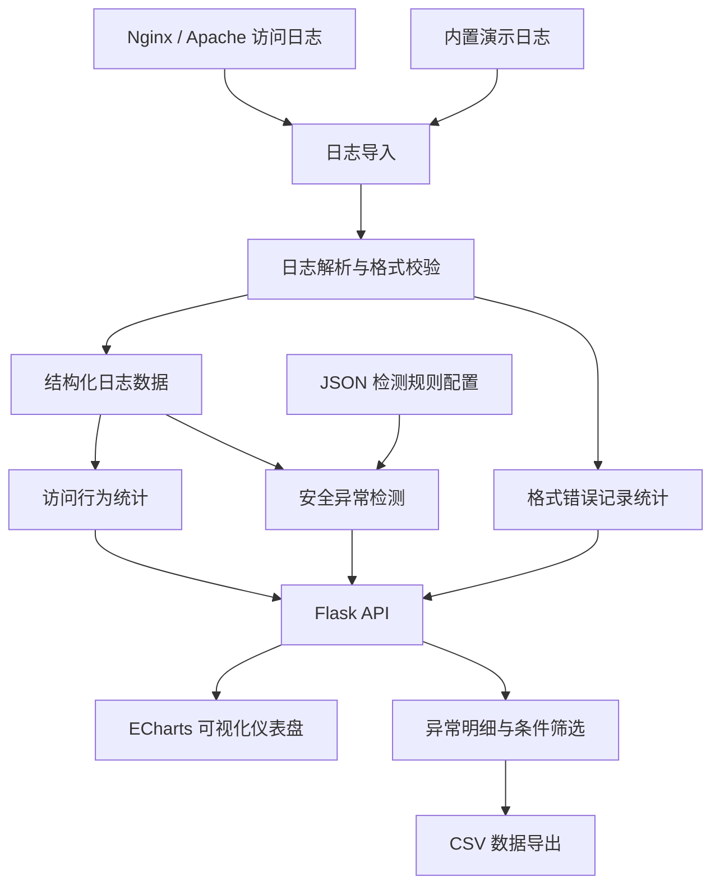

<h1 align="center">LogScope</h1>

<p align="center">
  <strong>网站访问日志可视化分析与异常检测工具</strong>
</p>

<p align="center">
  面向 Nginx / Apache 的轻量级日志分析平台，集日志解析、数据可视化与安全异常检测于一体。
</p>

<p align="center">
  
  
  
  
  
  
</p>

<p align="center">
  <a href="#主要功能">主要功能</a> ·
  <a href="#快速开始">快速开始</a> ·
  <a href="#系统架构">系统架构</a> ·
  <a href="#检测规则">检测规则</a> ·
  <a href="#api-接口">API 接口</a> ·
  <a href="#项目结构">项目结构</a>
</p>

---

## 项目简介

**LogScope** 是一款基于 Python、Flask 与 Apache ECharts 构建的网站访问日志可视化分析工具，旨在将原始 Web 服务器访问日志转换为直观、易于理解的数据图表与安全分析结果。

项目支持解析 Nginx / Apache 访问日志，通过请求特征匹配、访问频率统计和响应状态分析，识别潜在的 SQL 注入、路径遍历、目录扫描及登录暴力破解等异常行为，并提供交互式仪表盘、异常明细筛选和 CSV 数据导出能力。

LogScope 无需部署数据库，图表资源均随项目本地提供，适用于网络安全课程实践、Web 日志分析实验及本地安全审计演示。

> [!IMPORTANT]
> LogScope 当前主要面向本地日志分析与课堂教学场景。
> 规则命中仅代表潜在的安全风险，不能单独作为攻击成功的依据，也不建议直接将检测规则用于生产环境的自动拦截策略。

## 主要功能

### 日志解析

- 支持 Apache / Nginx Combined Log Format。
- 兼容缺少 Referer、User-Agent 字段的 Common Log Format。
- 自动提取来源 IP、访问时间、请求方法、请求路径、协议、响应状态码及响应字节数等字段。
- 支持格式错误记录的容错处理。
- 支持 `.log` 与 `.txt` 格式日志文件导入。

### 可视化分析

- 每小时访问量趋势统计。
- Top 10 来源 IP 排行。
- Top 10 请求 URL 排行。
- HTTP 状态码分布。
- HTTP 请求方法分布。
- 请求错误比例统计。
- 异常类别分布。

### 安全异常检测

- SQL 注入特征识别。
- 路径遍历与编码绕过特征识别。
- 敏感目录及文件扫描检测。
- 异常 HTTP 请求方法检测。
- 可疑 User-Agent 工具标识识别。
- 单 IP 高频访问检测。
- 单 IP 4xx / 5xx 响应比例异常检测。
- 登录失败及后续成功响应的时序分析。

### 数据管理

- 支持按风险等级、异常类别及关键字筛选。
- 支持异常明细分页浏览。
- 支持按当前筛选条件导出 CSV。
- CSV 文件使用 UTF-8 BOM 编码。
- 内置可重复生成的演示日志。
- 支持一键恢复演示数据。
- 不持久化保存用户上传的原始日志文件。

## 系统架构

LogScope 采用轻量级的前后端分层架构，由 Flask 提供页面服务及数据接口，Python 完成日志解析与规则检测，ECharts 负责统计结果的可视化展示。

| 组件 | 技术 | 职责 |
| --- | --- | --- |
| Web 服务 | Flask | 页面渲染、文件上传、JSON API 与 CSV 导出 |
| 日志分析引擎 | Python | 日志解析、数据清洗、访问统计与异常检测 |
| 规则配置 | JSON | 管理请求特征、检测阈值及风险规则 |
| 可视化模块 | Apache ECharts 5.5.1 | 访问趋势、分布统计及排行图表 |
| 前端交互 | HTML、CSS、JavaScript | 仪表盘、筛选、分页及文件导入 |
| 数据管理 | 进程内存 | 保存当前日志分析结果 |
| 自动化测试 | unittest | 验证解析逻辑、检测规则及 API 功能 |

整体数据处理流程如下：



> [!NOTE]
> 项目不依赖数据库或外部图表 CDN。
> ECharts 已随仓库提供，安装所需 Python 依赖后，可在离线环境中运行页面及图表。

## 快速开始

### 运行环境

| 环境 | 要求 |
| --- | --- |
| Python | 3.10 或更高版本 |
| 操作系统 | macOS / Linux / Windows |
| 浏览器 | 支持现代 JavaScript 的浏览器 |
| 数据库 | 无需安装 |
| 网络连接 | 安装依赖后可离线运行 |
| 日志格式 | `.log` / `.txt` |
| 上传限制 | 16 MB |

### macOS / Linux

在项目根目录下执行：

```bash
# 创建 Python 虚拟环境
python3 -m venv .venv

# 激活虚拟环境
source .venv/bin/activate

# 安装项目依赖
python -m pip install -r requirements.txt

# 启动 LogScope
python app.py
```

### Windows PowerShell

在项目根目录下执行：

```powershell
# 创建 Python 虚拟环境
py -3 -m venv .venv

# 激活虚拟环境
.venv\Scripts\Activate.ps1

# 安装项目依赖
python -m pip install -r requirements.txt

# 启动 LogScope
python app.py
```

### 访问应用

服务启动后，在浏览器中打开：

**[http://127.0.0.1:5000/](http://127.0.0.1:5000/)**

首页默认加载仓库中的 [`data/sample_access.log`](data/sample_access.log)，无需手动准备日志即可体验完整的分析流程。

| 操作 | 说明 |
| --- | --- |
| 导入日志 | 上传本地 `.log` 或 `.txt` 文件 |
| 恢复样例 | 重新加载项目内置演示日志 |
| 条件筛选 | 按风险等级、类别或关键字筛选异常记录 |
| 导出 CSV | 导出符合当前筛选条件的异常明细 |

> [!TIP]
> 首次运行时，建议先使用内置演示日志熟悉仪表盘与异常检测功能，再导入自己的 Nginx / Apache 访问日志。

## 演示数据

项目内置一份由固定随机种子生成的模拟访问日志，用于展示正常访问行为、异常请求特征及日志解析容错能力。

| 数据指标 | 数值 |
| --- | ---: |
| 日志总行数 | 10,301 |
| 有效日志 | 10,300 |
| 格式错误记录 | 1 |
| 数据来源 | 程序模拟生成 |
| 真实访客记录 | 无 |

所有模拟来源地址均使用 [RFC 5737](https://datatracker.ietf.org/doc/html/rfc5737) 定义的文档示例网段：

| 网段 | 用途 |
| --- | --- |
| `192.0.2.0/24` | TEST-NET-1 |
| `198.51.100.0/24` | TEST-NET-2 |
| `203.0.113.0/24` | TEST-NET-3 |

如需重新生成演示日志，在项目根目录执行：

```bash
python scripts/generate_sample_logs.py
```

生成脚本位于 [`scripts/generate_sample_logs.py`](scripts/generate_sample_logs.py)。

由于使用固定随机种子，演示数据具有可重复性，便于课堂展示与自动化测试。

## 检测规则

LogScope 采用基于请求特征与统计阈值的异常检测机制。

检测规则统一保存在：

[`config/detection_rules.json`](config/detection_rules.json)

可以通过修改配置文件调整检测特征及阈值，无需修改核心分析逻辑。

### 请求特征检测

| 异常类别 | 检测特征 | 默认风险 |
| --- | --- | --- |
| SQL 注入 | `UNION SELECT`、恒真条件、`SLEEP`、`BENCHMARK`、`information_schema` | 高 / 中 |
| 路径遍历 | `../`、编码及双重编码目录穿越 | 高 |
| 目录扫描 | `.env`、`.git`、phpMyAdmin、备份文件及管理入口 | 中 |
| 方法探测 | `TRACE`、`CONNECT` | 中 |
| 可疑 User-Agent | sqlmap、Hydra、dirsearch、Nikto、Masscan 等工具标识 | 高 / 中 / 低 |

### 访问行为检测

| 异常类别 | 默认触发条件 | 默认风险 |
| --- | --- | --- |
| 高频访问 | 同一 IP 在当前日志文件中累计请求数 ≥ 120 | 高 |
| 4xx 比例异常 | 单 IP 请求数 ≥ 10，且 4xx 响应占比 ≥ 72% | 高 / 中 |
| 5xx 比例异常 | 单 IP 请求数 ≥ 10，且 5xx 响应占比 ≥ 25% | 高 |
| 登录暴力破解 | POST 登录请求中至少出现 8 次 401 / 403 响应 | 中 |
| 登录失败后成功响应 | 满足登录爆破条件后出现 HTTP 200 响应 | 高 |

### 风险等级

| 等级 | 含义 |
| --- | --- |
| 🔴 高风险（High） | 具有较明显的异常特征或满足高风险行为规则，应优先复核 |
| 🟠 中风险（Medium） | 存在可疑访问行为，需要结合上下文进一步判断 |
| 🔵 低风险（Low） | 存在值得关注的特征，但不足以直接认定为攻击 |

### 检测机制说明

- SQL 注入与路径遍历规则会在 URL 解码后进行匹配，并包含一次额外解码，以覆盖常见的双重编码情况。
- 高频访问与错误比例按照整份导入日志计算，而非滑动时间窗口。
- 登录暴力破解检测结合失败响应次数与后续成功响应进行时序判断。
- 检测结果应结合来源地址、请求路径、响应状态、访问频率及业务背景进行人工复核。

> [!WARNING]
> HTTP 200 响应不一定代表登录成功，规则命中也不意味着攻击已经成功实施。
> 当前检测阈值主要用于课程实验和异常行为演示，实际使用时应根据业务场景进行调整。

## API 接口

LogScope 通过 Flask 提供 JSON 数据接口与 CSV 导出接口。

### 接口概览

| 方法 | 接口路径 | 用途 |
| --- | --- | --- |
| `GET` | `/api/health` | 获取服务状态 |
| `GET` | `/api/summary` | 获取统计指标及图表数据 |
| `GET` | `/api/anomalies` | 获取异常明细 |
| `GET` | `/api/anomalies/export.csv` | 导出异常记录 |
| `POST` | `/api/upload` | 上传并分析日志文件 |
| `POST` | `/api/sample` | 恢复内置演示日志 |

### 异常明细查询参数

`GET /api/anomalies`

| 参数 | 用途 |
| --- | --- |
| `severity` | 按风险等级筛选 |
| `category` | 按异常类别筛选 |
| `q` | 按关键字搜索 |
| `page` | 指定查询页码 |
| `page_size` | 指定每页记录数量 |

### 接口调用示例

检查服务状态：

```bash
curl http://127.0.0.1:5000/api/health
```

获取统计数据：

```bash
curl http://127.0.0.1:5000/api/summary
```

查询异常记录：

```bash
curl "http://127.0.0.1:5000/api/anomalies?page=1&page_size=20"
```

按来源 IP 搜索：

```bash
curl "http://127.0.0.1:5000/api/anomalies?q=203.0.113.77"
```

上传日志文件：

```bash
curl -X POST \
  -F "logfile=@access.log" \
  http://127.0.0.1:5000/api/upload
```

导出异常明细：

```bash
curl -o anomalies.csv \
  http://127.0.0.1:5000/api/anomalies/export.csv
```

恢复内置演示数据：

```bash
curl -X POST http://127.0.0.1:5000/api/sample
```

## 项目结构

```text
LogScope/
├── app.py                          # Flask 页面服务与 API
├── log_analyzer.py                 # 日志解析、统计与异常检测
├── requirements.txt                # 项目运行依赖
├── requirements-report.txt         # 项目报告生成依赖
│
├── config/
│   └── detection_rules.json        # 检测特征与阈值配置
│
├── data/
│   └── sample_access.log           # 内置演示日志
│
├── scripts/
│   ├── generate_sample_logs.py     # 演示日志生成脚本
│   └── build_report.py             # 项目报告生成脚本
│
├── static/
│   ├── css/
│   │   └── dashboard.css           # 仪表盘页面样式
│   ├── js/
│   │   └── dashboard.js            # 图表渲染与前端交互
│   └── vendor/
│       ├── echarts.min.js          # 本地 ECharts 5.5.1
│       └── THIRD-PARTY-NOTICE.md   # 第三方组件声明
│
├── templates/
│   └── index.html                  # 仪表盘页面模板
│
├── tests/                          # 自动化测试
├── report/                         # 项目报告与渲染质检文件
└── README.md                       # 项目说明文档
```

## 自动化测试

项目使用 Python 标准库 `unittest` 进行自动化测试。

在项目根目录下执行：

```bash
python -m unittest discover -s tests -v
```

测试覆盖范围：

- 日志格式与字段解析。
- 格式错误记录的容错处理。
- 请求特征与异常检测规则。
- 登录暴力破解时序判断。
- 10,000 行以上演示日志分析。
- Flask 页面及 API 接口。
- 日志文件上传。
- 异常明细筛选与分页。
- CSV 文件导出。

建议在修改日志解析逻辑、检测规则或 API 接口后重新运行测试，以验证核心功能的稳定性。

## 课堂演示

以下流程适用于约 10 分钟的课程项目展示。

| 时间 | 演示内容 | 展示重点 |
| --- | --- | --- |
| 00:00 – 01:00 | 项目介绍与首页展示 | 技术栈、项目定位及内置日志 |
| 01:00 – 03:00 | 可视化仪表盘 | 访问趋势、状态码分布、高频来源 IP |
| 03:00 – 05:00 | 高风险异常筛选 | SQL 注入、目录扫描、路径遍历 |
| 05:00 – 07:00 | 登录暴力破解分析 | 失败响应与后续成功响应的时序关系 |
| 07:00 – 08:00 | CSV 数据导出 | 规则、来源、请求路径及命中说明 |
| 08:00 – 10:00 | 自定义日志导入 | 日志兼容性、动态分析与样例恢复 |

### 推荐演示步骤

1. 启动应用并打开首页，介绍 10,301 行演示日志，其中包含 10,300 行有效日志和 1 行格式错误记录。
2. 查看访问趋势、状态码分布与高频来源 IP，重点观察凌晨时段的扫描请求峰值。
3. 在异常明细中选择「高风险」，查看 SQL 注入、目录扫描及路径遍历等异常记录。
4. 搜索 `203.0.113.77` 或筛选「暴力破解」，分析 HTTP 401 失败响应与后续 HTTP 200 响应的时序关系。
5. 点击「导出 CSV」，检查导出文件中的检测规则、来源地址、请求路径及命中说明。
6. 上传课程提供的 Combined 格式日志，展示自定义日志分析能力。
7. 点击「恢复样例」，将系统恢复至初始演示状态。

## 项目报告

项目报告及相关资源位于 [`report/`](report/) 目录，包括：

- Word 格式项目报告。
- Markdown 格式报告源稿。
- 系统架构图。
- 报告渲染与质量检查文件。

如需重新生成项目报告，执行：

```bash
# 安装报告生成依赖
python -m pip install -r requirements-report.txt

# 生成项目报告
python scripts/build_report.py
```

### 中文字体配置

如果系统未能自动识别可用的中文字体，可通过环境变量 `LOGSCOPE_CJK_FONT` 指定本机字体文件。

支持以下字体格式：

- `.ttf`
- `.ttc`
- `.otf`

macOS / Linux：

```bash
export LOGSCOPE_CJK_FONT="/path/to/chinese-font.ttf"
python scripts/build_report.py
```

Windows PowerShell：

```powershell
$env:LOGSCOPE_CJK_FONT = "C:\path\to\chinese-font.ttf"
python scripts/build_report.py
```

请将示例路径替换为本机实际存在的中文字体文件路径。

## 数据与隐私

LogScope 采用本地分析模式，不需要将日志上传至第三方分析平台。

| 数据类型 | 处理方式 |
| --- | --- |
| 内置演示日志 | 保存在项目 `data/` 目录 |
| 用户上传日志 | 由当前 Flask 进程处理，不持久化保存 |
| 日志分析结果 | 保存在当前 Python 进程内存中 |
| 检测规则 | 保存在本地 JSON 配置文件中 |
| 图表资源 | 使用仓库内置 ECharts |
| CSV 导出文件 | 由用户自行保存 |

当前版本在进程内仅维护一份分析结果，不提供多用户数据隔离及持久化存储能力。

> [!NOTE]
> 真实服务器访问日志可能包含来源 IP、敏感请求参数及其他业务信息。
> 在进行课堂展示或共享分析结果前，建议对相关数据进行必要的脱敏处理。

## 已知边界

LogScope 当前主要面向本地分析与教学实践，存在以下使用边界：

- **来源 IP 识别**

  仅使用日志首字段作为来源 IP，不会自行信任或解析代理请求头。如需获取真实访客地址，应由 Nginx / Apache 配置可信的 Real-IP 字段，并将其写入访问日志。

- **请求内容可见性**

  仅分析日志中可见的请求行及 User-Agent，不读取 HTTP 请求体，因此无法识别仅出现在 POST 请求体中的注入内容。

- **统计时间范围**

  高频访问与错误比例基于整份导入文件计算，暂不支持滑动时间窗口或实时流式检测。

- **数据存储与用户隔离**

  分析结果保存在当前 Python 进程中，不支持多用户隔离、历史分析结果持久化及数据库存储。

- **规则检测准确性**

  User-Agent 与 URL 特征可能被伪造或编码，规则检测存在误报与漏报，需要结合实际业务场景进行人工复核。

## 鸣谢

LogScope 的实现使用了以下技术与组件：

- [Python](https://www.python.org/) — 日志解析、统计分析与异常检测。
- [Flask](https://flask.palletsprojects.com/) — 轻量级 Web 应用框架。
- [Apache ECharts](https://echarts.apache.org/) — 交互式数据可视化组件。
- [Nginx](https://nginx.org/) — Web 服务器及访问日志格式参考。
- [Apache HTTP Server](https://httpd.apache.org/) — Common / Combined 日志格式参考。
- [RFC 5737](https://datatracker.ietf.org/doc/html/rfc5737) — 演示日志 IPv4 示例地址规范。

第三方前端组件相关声明位于
[`static/vendor/THIRD-PARTY-NOTICE.md`](static/vendor/THIRD-PARTY-NOTICE.md)。

## 使用说明

本项目主要用于网络安全教学、Web 访问日志分析、异常行为研究及课程实践。

检测结果仅供分析与辅助判断，不构成对攻击行为或攻击成功的最终认定。

---

<p align="center">
  <strong>LogScope</strong>
</p>

<p align="center">
  让日志可读，让行为可视，让异常可循。
</p>

<p align="center">
  Make Logs Readable. Make Behavior Visible.
</p>
